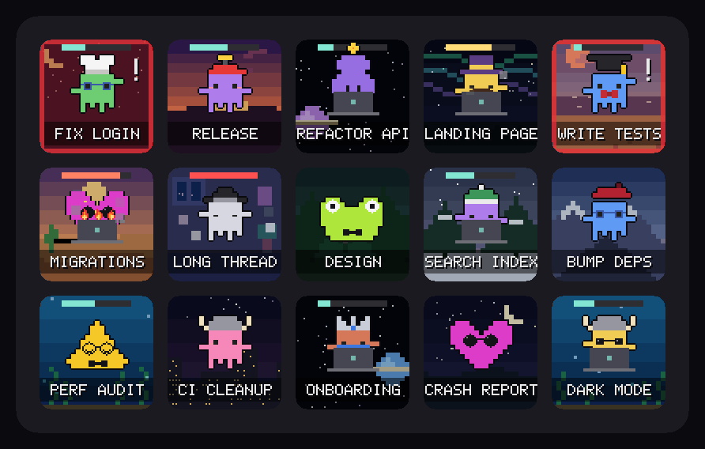
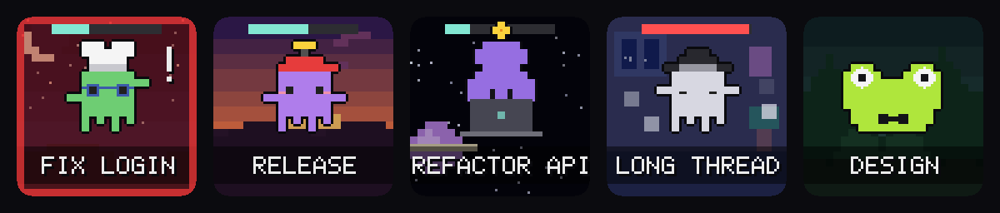
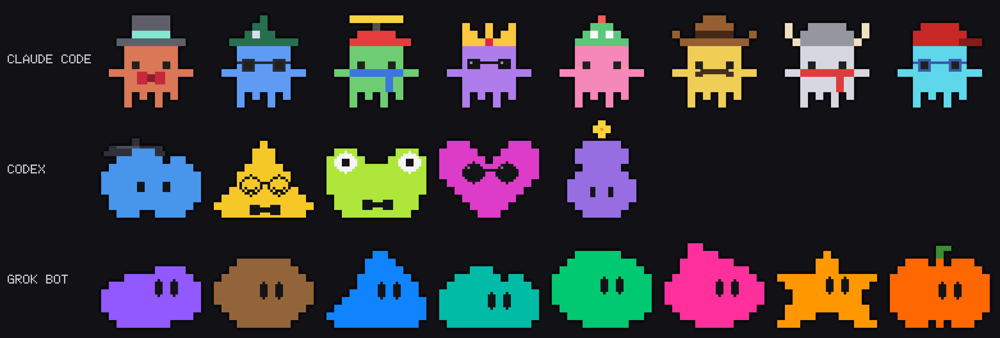
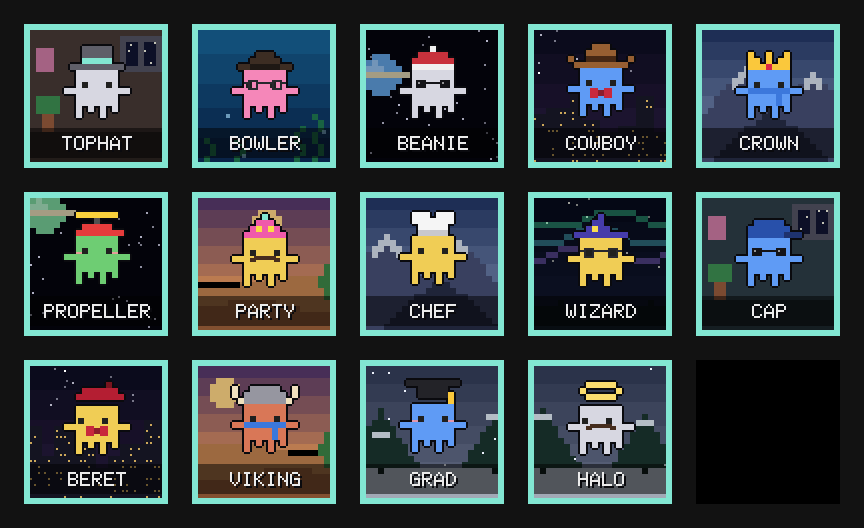
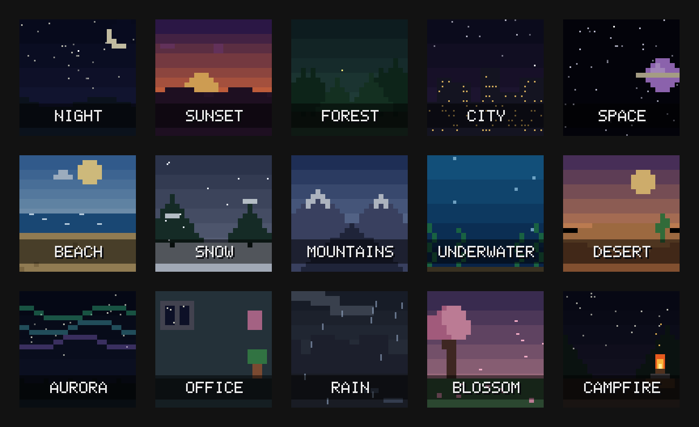
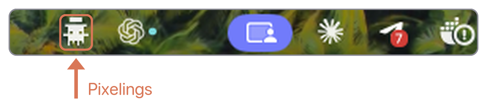
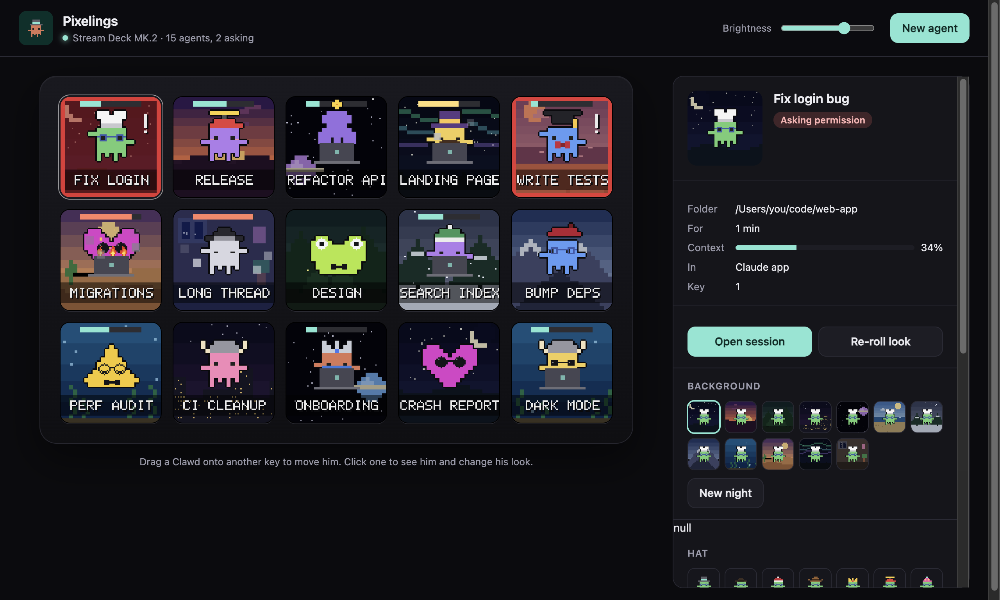

# Pixelings

**A little pixel character for every agent you run: Claude Code, Codex and
Grok Bot.**

[](https://ko-fi.com/adrianrosariopr)



Every Claude Code session, Codex thread and Grok Bot bot on your Mac becomes a
character on an Elgato Stream Deck key. He types while his agent works, pulses
red when he needs you, and one press of his key takes you to his session. A
menu bar app drives the deck.

Unofficial fan project, not affiliated with or endorsed by Anthropic, OpenAI
or SpaceXAI. The characters are pixel renditions of each app's own.

## What's in here

| Part | What it is |
|------|------------|
| **The Pixelings app** (`host/deck`) | A macOS menu bar app that drives the Stream Deck and has a window to arrange and dress your characters. |
| **The `pixelings` plugin** (`plugin`) | Claude Code hooks that tell Pixelings what every session is doing. Codex and Grok Bot need nothing: Pixelings reads their own files. |

## On the Stream Deck



- **Asking you something** (a permission or a question): the key pulses red
  and a "!" blinks. This is the one to look for.
- **Your move**: his turn is done and he waits for your next prompt, for up
  to half an hour.
- **Working**: he types behind his laptop.
- **Compacting**: his scene turns blue.
- **Idle**: nothing new for half an hour. After two hours idle he leaves the
  deck until he does something (change it in **Settings → Agents**).

Under him is what he is doing, or his session's name while he is idle. The
bar over his hat is how full his context is. Each session keeps its key while
it runs; with more than 15, the last key pages through the rest.

**Flashes.** A key can also flash when he asks a question (on by default),
asks permission, has just finished, waits for you, is compacting, or has his
context 90% full. Set the style, colour and speed of each under
**Settings → Flash**, with a live preview.

### The characters



A Claude Code session is **Clawd**, a Codex thread is one of the **Codex
dots**, and a Grok Bot bot looks as it does in the Grok Bot app. Each new one
gets a hat, colour, accessory and background that no other live session has,
and keeps them.



#### Backgrounds



### The app



The menu bar icon shows a count with a "!" when an agent asks for you. Its
menu opens the window or its Settings (⌘,).



**Where they show.** **Settings → Display** lists each place the Pixelings
can show, each with a switch, on together or one at a time: the **Stream
Deck**'s keys; a **Scene**, a farm they live in (an office or a mall if you
like) on a screen you pick (a Corsair Xeneon Edge is found by itself), that
fills the screen, sits in a window you move and size, or runs as a strip
along its top or bottom; and the **Desktop**, where they walk along the
bottom of a screen (your main one, or one you pick) just above the Dock or
the taskbar, with nothing behind them. On the Desktop a click on one opens
his session, and a click anywhere else goes to the window under them.
They stay behind the window you are using, and one asking you something
comes to the front until you answer it (or keep them all on top). The
ESP32 Board is coming. The menu bar and the window are always there.

The window shows the deck live, plugged in or not. Drag a character to move
him (or swap him with another), click one to open his session or change his
look, start a new agent, or open **Settings**.

A key press opens that session in its own app (Claude, VS Code, Cursor,
T3 Code, Codex or Grok Bot), or its own tab for a session in a terminal
(Ghostty, Terminal or iTerm2, inside tmux too; on a Mac). The first press
in each terminal asks you to let Pixelings control it; without that, the
terminal still comes to the front.

### How it knows

```
Claude Code ── hooks (pixelings plugin) ──▶ one small file per session
                                                       │
~/.claude/sessions (which sessions are running) ───────┤
~/.t3 (which T3 Code thread each session is) ──────────┤
~/.codex/sessions (Codex's own session logs) ──────────┤
Grok Bot app's saved bot list and chats ───────────────┤
                                                       ▼
                                       Pixelings ──▶ Stream Deck keys
                                           └───────▶ the window and the menu
```

- The plugin's hooks run in the background, so Claude never waits on them.
- Grok Bot's working state is a guess, and its context isn't known.
- Agents started by scripts, the Agent SDK or other agents are hidden unless
  you turn on **Show agents started by other agents** in **Settings → Agents**.
- Everything stays on your computer.

## Get started

You need:

- A Mac with Apple silicon, or a Windows PC.
- [Claude Code](https://claude.com/claude-code) 2.1.275 or newer, Codex,
  and/or the Grok Bot app.
- An Elgato Stream Deck with screen keys. It is made on an MK.2 (15 keys);
  others should work but are untested.

> [!NOTE]
> Quit Elgato's own Stream Deck app: it holds the deck.

**1. Add the plugin** in Claude Code:

```
/plugin install pixelings --marketplace Invisionnaire-LLC/Pixelings
```

**2. Download the app** from the [latest release](https://github.com/Invisionnaire-LLC/Pixelings/releases/latest):

- **Mac** (Apple silicon): [Pixelings-mac-arm64.dmg](https://github.com/Invisionnaire-LLC/Pixelings/releases/latest/download/Pixelings-mac-arm64.dmg).
  Drag Pixelings onto Applications.
- **Windows**: [Pixelings-windows-x64-setup.exe](https://github.com/Invisionnaire-LLC/Pixelings/releases/latest/download/Pixelings-windows-x64-setup.exe).
  It installs for your user, no admin needed.

Pixelings starts in the menu bar (on Windows, the system tray) and at every
login. Without the plugin, Claude Code sessions show only as working or idle.

<details>
<summary><b>Or build it yourself</b> from a clone (needs <a href="https://nodejs.org">Node.js</a> 20 or newer; works on Intel Macs too)</summary>

```bash
git clone https://github.com/Invisionnaire-LLC/Pixelings.git
```

On a Mac, this builds Pixelings.app, puts it in Applications and starts it
(`--uninstall` removes it):

```bash
Pixelings/host/deck/install-app.sh
```

On Windows, in PowerShell (`-Uninstall` removes it):

```powershell
powershell -ExecutionPolicy Bypass -File Pixelings\host\deck\install-app.ps1
```

Run the script again after pulling to update.

</details>

| | Saved looks and settings | Log |
|---|---|---|
| macOS | `~/Library/Application Support/Pixelings` | `~/Library/Logs/Pixelings/pixelings.log` |
| Windows | `%APPDATA%\Pixelings` | `%LOCALAPPDATA%\Pixelings\Logs\pixelings.log` |

## Development

In `host/deck`:

| Command | What it does |
|---------|--------------|
| `npm run app` | Runs Pixelings from the repo (without registering it to start at login). |
| `npm start` | Runs the same deck and window as a plain Node script, with no menu bar. |
| `npm test` | The deck's tests (also `npm test` in `plugin`). |
| `npm run dist` | Builds the app for this system into `dist/`. |
| `npm run release` | Also wraps it as the release download in `dist/release` (Windows needs [Inno Setup](https://jrsoftware.org/isinfo.php)). |
| `npm run media` | Redraws the README's pictures from the demo deck. |
| `npm run agents` | Exports every character option as pictures into `docs/agents`. |
| `node preview.js out.png` | Draws your live keys into a PNG (`--sample`, `--wardrobe`, `--scenes` for the demo pictures). |

Run only one of the app, `npm run app` and `npm start` at a time: they share
the deck and port 47733 (or `PIXELINGS_PORT`). Pushing a version tag
(`git tag v0.1.0 && git push origin v0.1.0`) has GitHub Actions build and
publish both downloads.

```
host/deck/      Pixelings: main.js (the app), device.js (the Stream Deck),
                hub.js (sessions, looks, seats), render.js and scenes.js (the
                keys), wardrobe.js (hats and accessories), server.js and
                public/ (the window), demo.js (the made-up deck in the README)
plugin/         the pixelings Claude Code plugin; .claude-plugin/ at the
                root lists it
docs/           previews and designs
```

## What's next

- **A "+" key on the deck** to start a new agent.
- **Long press an asking key** to jump to every session waiting for you.
- **More agents** besides Claude Code, Codex and Grok Bot.
- **Updates from the app**, installed with one click.
- **Usage and budget** on a key: 5-hour and 7-day usage and cost.

## License

Pixelings is free software under the [GNU General Public License v3](LICENSE),
with one added term in [NOTICE](NOTICE): fork it, change it and share it, as
long as your version stays open source under the same license and keeps the
credit "Pixelings by Invisionnaire LLC" with a link back here, in its About
screen and its README.

## Support Pixelings

Pixelings is free and made in spare time. If it keeps your agents in line,
you can buy me a coffee:

[](https://ko-fi.com/adrianrosariopr)
