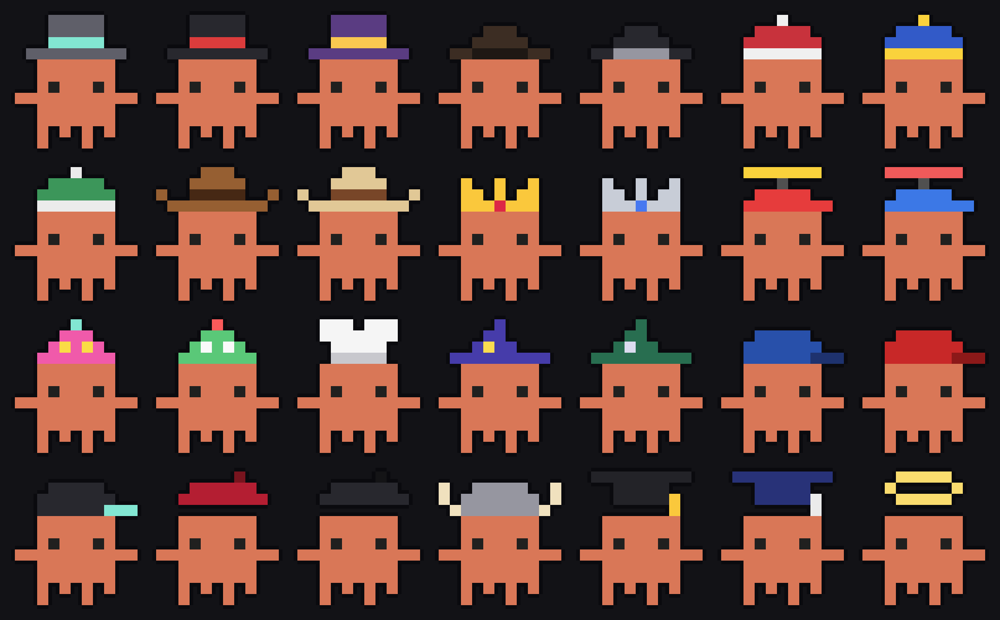
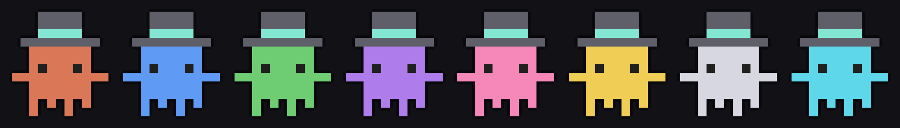
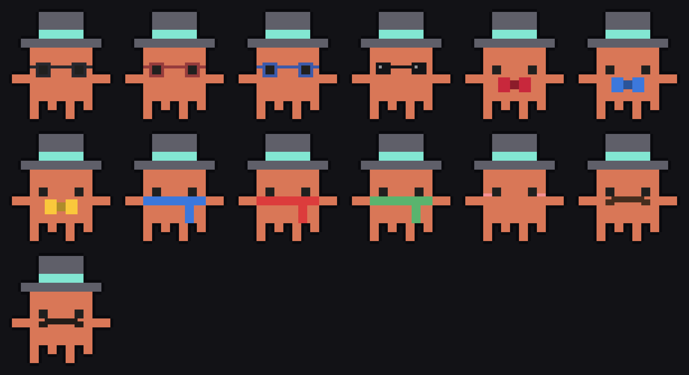
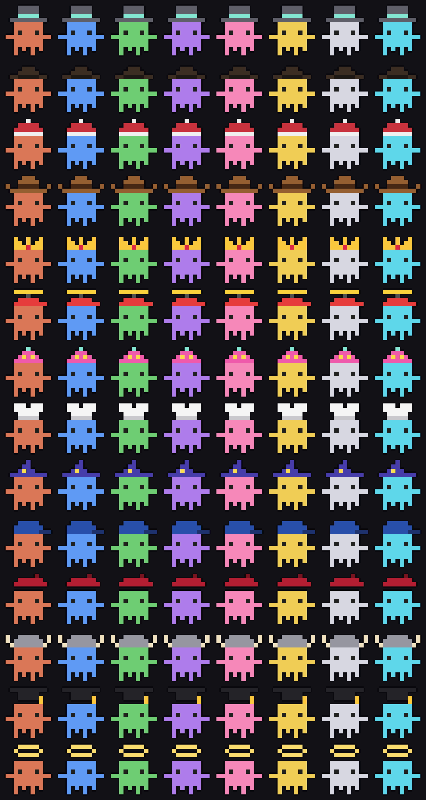
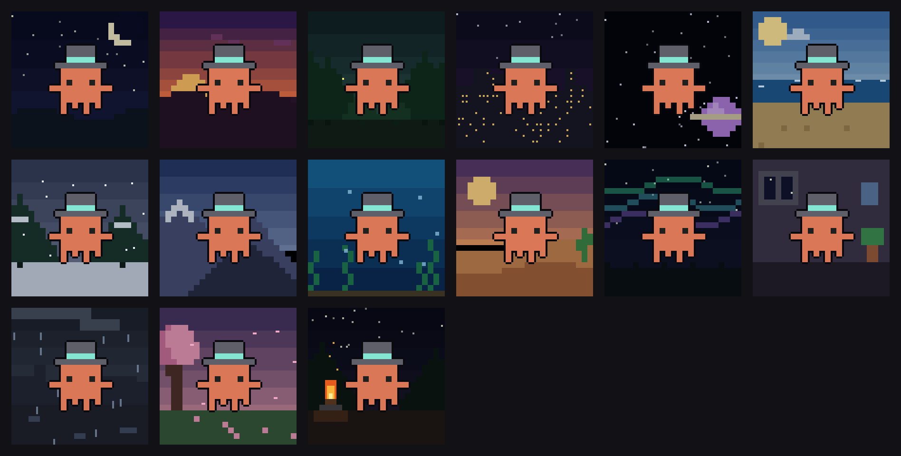
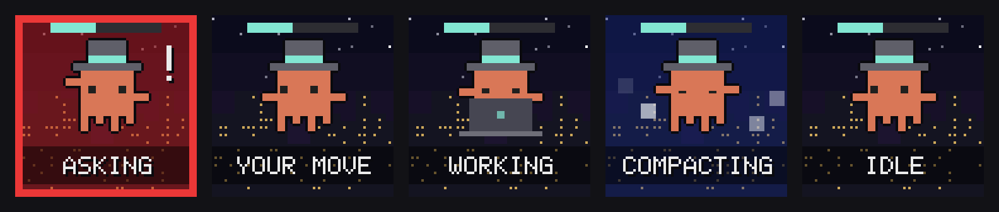

# Every Pixelings character option

Each option a character can have, as its own picture, exported by
`host/deck/export-agents.js` (`npm --prefix host/deck run agents` redoes them
all, and this page). The characters are stickers: outlined, on a clear
background, cropped close.

| Folder | What | Count |
|--------|------|-------|
| `characters/` | Clawd (Claude Code) in every body colour, every Codex dot, and some Grok bots | 21 |
| `hats/` | every hat, in each of its colours | 28 |
| `colors/` | every body colour, in the classic top hat | 8 |
| `accessories/` | every accessory, in each of its colours | 13 |
| `combinations/` | every hat with every body colour | 112 |
| `backgrounds/` | every background on its own | 15 |
| `backgrounds-with-clawd/` | every background with Clawd in it | 15 |
| `states/` | every state, as its Stream Deck key shows it | 5 |
| `sheets/` | one overview picture per folder | 8 |

## Characters

## Hats

## Colours

## Accessories

## Hats with colours

## Backgrounds

## States

